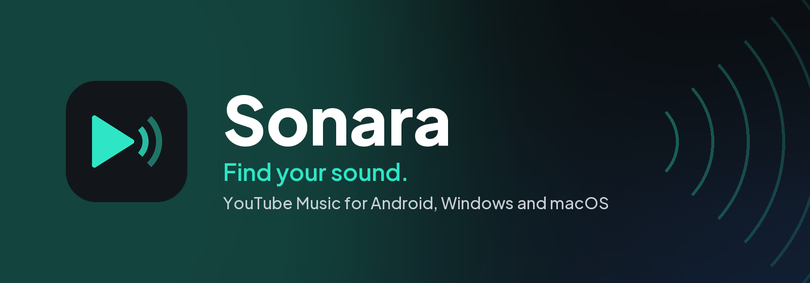

<p align="center">
  
</p>

<p align="center">
  <a href="../../releases/latest"></a>
  
  <a href="LICENSE"></a>
</p>

<p align="center">
  <b>Sonara</b> is a fast, clean YouTube Music player for your phone and your computer.<br>
  Sign in once, and your library, playlists and history follow you everywhere, with no ads and no clutter.
</p>

<p align="center">
  <a href="../../releases/latest"></a>
  <a href="../../releases/latest"></a>
  <a href="../../releases/latest"></a>
  <a href="../../releases/latest"></a>
</p>

---

## ✨ Why Sonara

- **All of YouTube Music, none of the noise.** Your library, liked songs, playlists, mixes and recommendations, without ads or distractions.
- **One account, every device.** What you like, save or play on your phone shows up on your computer, and the other way round.
- **Lyrics that keep up.** Synced lyrics from eight sources, lit word by word when the song has it, and translated into your language by AI.
- **Made for each screen.** A light Android app, and a real desktop app for Windows, macOS and Linux, not a website in a window.

## 🎧 Features

| | |
|---|---|
| 🔐 **Google sign-in** | Your YouTube Music account, with library, likes, playlists and history kept in sync |
| 🔎 **Search** | Songs, albums, artists, playlists and podcasts, with suggestions as you type |
| 🏠 **Home and Browse** | Recommendations, mixes, charts, moods and genres |
| 🎤 **Lyrics** | Eight sources, synced line by line or word by word |
| 🌐 **AI lyric translation** | Built in: turn it on in Settings, choose a language, and lyrics are translated as they load |
| 📻 **Radio and autoplay** | Endless music from any song or artist |
| ⬇️ **Downloads** | Keep songs for offline listening |
| 📝 **Playlists** | Create, edit, reorder, collaborate with friends, and import from a link |
| 🌙 **Sleep timer** | Stop after a set time or at the end of the song |
| 🔊 **Sound** | Normalized volume and mono audio |

**On Android** — Google Cast to your TV or speaker, song recognition for what's playing around you,
and the system's media controls on the lock screen and in notifications.

**On Windows, macOS and Linux** — a full-screen player with a turning record and big lyrics, a mini
player that stays on top, an equalizer, crossfade, media keys and the system's media controls,
keyboard shortcuts, playing on from the tray or menu bar, and opening at sign-in.

## 📥 Install

Download the file for your device from the [latest release](../../releases/latest).

<details>
<summary><b>Android</b> · <code>Sonara-2.4.1.apk</code> · Android 8.0 or newer</summary>

1. Open the APK on your phone.
2. If asked, allow your browser or file manager to install apps.
3. Tap **Install**. A newer version installs over the old one and keeps your data.

</details>

<details>
<summary><b>Windows</b> · <code>Sonara-2.4.1.msi</code> · Windows 10 or 11, 64-bit</summary>

1. Run the MSI. If SmartScreen appears, choose **More info → Run anyway**.
2. Follow the installer; it installs for your user, no administrator needed.
3. A newer version replaces the old one and keeps your data.

</details>

<details>
<summary><b>macOS</b> · <code>Sonara-2.4.1-mac-arm64.dmg</code> or <code>Sonara-2.4.1-mac-intel.dmg</code> · macOS 12 or newer</summary>

Take **arm64** for a Mac with Apple Silicon (M1 and later), **intel** for an Intel Mac. Not sure?
Apple menu → **About This Mac**: "Chip Apple M…" is Apple Silicon, "Processor Intel" is Intel.

1. Open the DMG and drag **Sonara** into **Applications**.
2. Open Sonara. The app isn't signed by Apple, so macOS asks first: go to
   **System Settings → Privacy & Security** and click **Open Anyway**.
3. If macOS says the app is damaged or can't be opened, run this once in Terminal:

   ```bash
   sudo xattr -dr com.apple.quarantine /Applications/Sonara.app
   ```

</details>

<details>
<summary><b>Linux</b> · <code>Sonara-2.4.1-linux-amd64.deb</code> or <code>Sonara-2.4.1-linux-x86_64.AppImage</code> · 64-bit PC</summary>

**Debian, Ubuntu, Linux Mint and the like:** install the .deb, by opening it or with

```bash
sudo apt install ./Sonara-2.4.1-linux-amd64.deb
```

Sonara then shows in your apps. A newer .deb installs over the old one and keeps your data.

**Any other distribution:** the AppImage runs as it is, no installing needed:

```bash
chmod +x Sonara-2.4.1-linux-x86_64.AppImage
./Sonara-2.4.1-linux-x86_64.AppImage
```

Signing in opens Google's page in **Google Chrome, Chromium, Microsoft Edge, Brave or Vivaldi**
(Firefox can't be used for it), so one of them needs to be installed. What plays shows in GNOME's
and KDE's media controls, and the media keys work through them.

</details>

## ⌨️ Desktop shortcuts

`Ctrl` on Windows and Linux, `⌘` on a Mac.

| Keys | Does |
|---|---|
| `Ctrl/⌘ K` | Search |
| `Space` or `K` | Play / pause |
| `Ctrl/⌘ →` / `Ctrl/⌘ ←` | Next / previous song |
| `→` / `←` | Forward / back 5 seconds |
| `L` / `J` | Forward / back 10 seconds |
| `↑` / `↓` | Volume up / down |
| `M` | Mute |
| `F` | Full screen |
| `Q` | Queue |
| `Ctrl/⌘ L` | Lyrics |
| `Ctrl/⌘ S` / `Ctrl/⌘ R` | Shuffle / repeat |
| `Ctrl/⌘ D` | Like the song |
| `Ctrl/⌘ ,` | Settings |
| `Alt ←` / `Alt →` | Back / forward between pages |

## 🛠️ Build from source

You need JDK 21; the Android app also needs the Android SDK. The AI translator works out of the
box: its key is built in, sealed, so there is nothing to set up.

```bash
./gradlew :app:assembleFossRelease        # Android APK
./gradlew -p desktop packageInstaller     # Windows installer (on Windows)
./gradlew -p desktop packageDmg           # macOS disk image (on a Mac)
./gradlew -p desktop packageDeb           # Linux .deb (on Linux; desktop/linux/make_appimage.sh for the AppImage)
./gradlew -p desktop run                  # run the desktop app
```

No Mac or Linux at hand? The **macOS app** and **Linux app** workflows in the **Actions** tab build
them on GitHub's machines. More notes are in [AGENTS.md](AGENTS.md).

## 💚 Credits

Sonara is based on [**Metrolist**](https://github.com/MetrolistGroup/Metrolist). Thank you to the
Metrolist project for the foundation this app is built on.

## 📄 License

Sonara is free software under the [GNU General Public License v3.0](LICENSE).

Sonara is not affiliated with YouTube, YouTube Music, Google or Metrolist. Playback uses YouTube's
unofficial API and may stop working when YouTube changes it.
